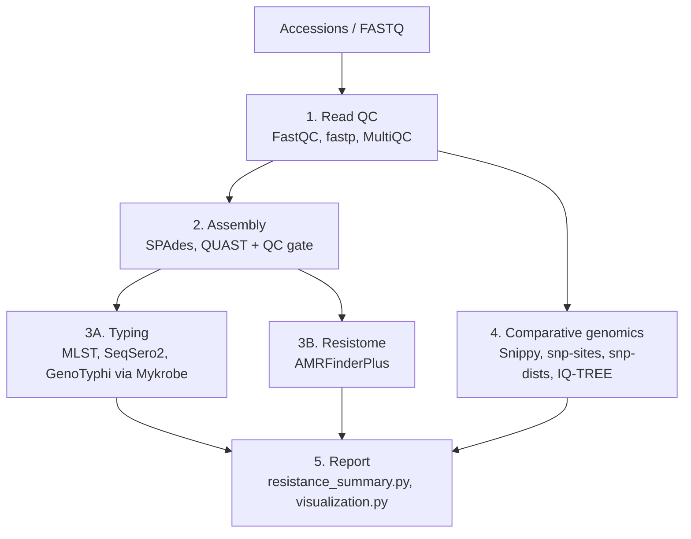

# TyphiWatch

**Whole-genome sequencing surveillance workflow for *Salmonella enterica* serovar Typhi**
Nextflow (DSL2) + Docker, with Python for downstream summaries and figures.

From public SRA/ENA reads (or your own FASTQ files) to: QC, assemblies, MLST / serotype /
GenoTyphi genotype, AMR and MDR/XDR calls, core-SNP phylogeny, and annotated figures.

> Status: v0.1, under development. Container tags are listed in `nextflow.config`;
> verify them on first run (see *Troubleshooting*). AMR output is genotype-based and is
> not a substitute for phenotypic susceptibility testing.

## Workflow



## Requirements
* Linux/macOS, Java 17+, [Nextflow](https://www.nextflow.io) >= 23.10
* Docker (recommended), Singularity, or conda/mamba
* Disk: roughly 2-5 GB per 10 isolates (reads + assemblies + work directory)
* RAM: SPAdes is the heaviest step (default 16 GB per sample; use `-profile laptop` to reduce)

## Quick start
```bash
git clone https://github.com/NailaZaman/TyphiWatch.git && cd TyphiWatch
mamba env create -f environment.yml && conda activate typhiwatch

# 1. Choose isolates (edit data/accession_list.tsv, or search ENA)
python scripts/metadata_processing.py search --country Pakistan --max 40
#    copy the accessions you want into data/accession_list.tsv

# 2. Build the samplesheet + metadata and fetch the reference genome
python scripts/metadata_processing.py resolve --max-per-accession 4   # small first run
python scripts/metadata_processing.py reference

# 2b. Check that every container tag in nextflow.config can be pulled
bash scripts/check_containers.sh

# 3. Run the pipeline
nextflow run workflows/main.nf -profile docker            # add ,laptop on small machines

# 4. Summaries and figures
python scripts/resistance_summary.py
python scripts/visualization.py
```

The bundled `data/accession_list.tsv` contains a Pakistan XDR isolate (SRX7117257) and a
Bangladesh study (ERP109468) to subsample with `--max-per-accession`. A phylogeny requires
at least 4 isolates (`min_phylo_samples`).

### Using your own reads
Create `data/metadata/samplesheet.csv`:
```
sample,fastq_1,fastq_2
isolate01,/path/isolate01_R1.fastq.gz,/path/isolate01_R2.fastq.gz
```
`fastq_*` can be local paths or http/https/ftp URLs. Metadata (country, year) is optional
but enables the per-country and per-year figures: provide `data/metadata/metadata.tsv`
with columns `sample, country, year` (extra columns are ignored).

## Repository layout
```
workflows/main.nf         orchestration, QC gate, channel wiring
modules/                  qc, assembly, typing, resistance, phylogeny processes
scripts/
  metadata_processing.py  ENA search / accession resolution / reference download
  check_containers.sh     pulls every container in nextflow.config, suggests fixes
  resistance_summary.py   AMR calls + typing + metadata merge
  visualization.py        figures (matplotlib; plotly optional)
docs/methodology.md       methods and limitations
docs/interpretation.md    how to read the outputs, MDR/XDR rules
```

## Key parameters
Set on the command line (`--param value`) or in `nextflow.config`.

| Parameter | Default | Meaning |
|-----------|---------|---------|
| `samplesheet` | `data/metadata/samplesheet.csv` | input table |
| `reference` | `data/reference/CT18_AL513382.1.gbk` | SNP-calling reference |
| `outdir` | `results` | output directory |
| `min_genome_size` / `max_genome_size` | 4.3 / 5.5 Mb | assembly QC gate |
| `min_n50` | 20000 | assembly QC gate |
| `run_seqsero2`, `run_genotyphi`, `run_phylogeny` | true | toggle steps |
| `amrfinder_db` | null | existing AMRFinderPlus DB (otherwise downloaded once) |
| `iqtree_model`, `iqtree_bootstraps` | GTR+G+ASC, 1000 | tree inference |

## Outputs
See `docs/interpretation.md`. Main files: `results/qc/multiqc_report.html`,
`results/resistance/sample_summary.tsv`, `results/phylogeny/typhiwatch.treefile`,
`results/figures/`.

## Troubleshooting
* **Container pull fails**: the image tag is wrong or retired. Find the current tag at
  `https://quay.io/repository/biocontainers/<tool>?tab=tags` and edit `params.containers`.
  Alternatively run `-profile conda`.
* **Mykrobe/SeqSero2 produce nothing**: they are non-blocking. Check
  `work/.../.command.err`; CLI flags can differ between versions.
* **`genotype` is NA**: see the note on `parse_mykrobe()` in `docs/interpretation.md`.
* **No tree**: fewer than 4 isolates passed QC.
* **Out of memory in SPAdes**: use `-profile docker,laptop` or lower the `process_high` label.

## Data and tool credits
Reads come from public archives (ENA/NCBI SRA); cite the original studies for any
dataset you analyse. Core tools: fastp, FastQC, MultiQC, SPAdes, QUAST, mlst, SeqSero2,
Mykrobe/GenoTyphi, AMRFinderPlus, Snippy, snp-sites, snp-dists, IQ-TREE.

## Citation and licence
See `CITATION.cff`. Released under the MIT licence (`LICENSE`).
